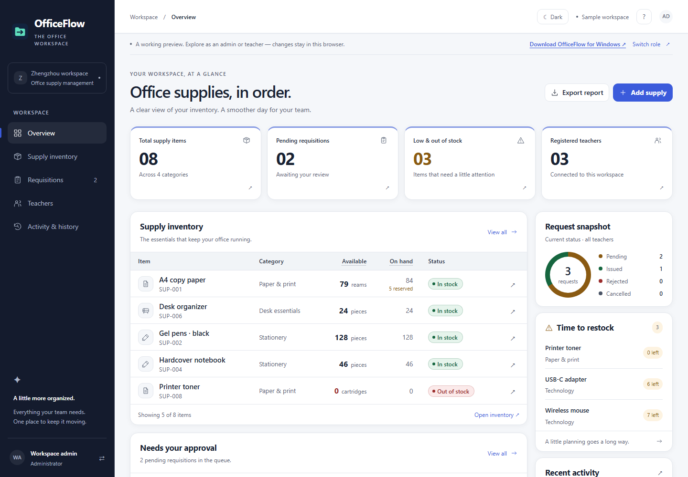
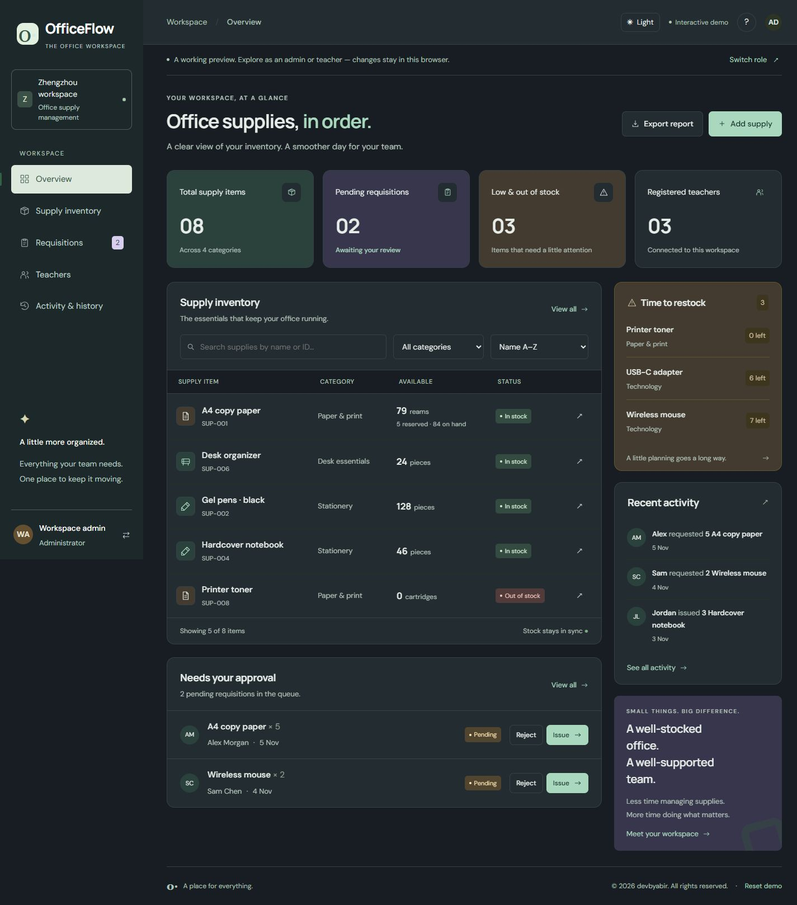

<div align="center">

# OfficeFlow

**Office supplies, in order.**

An inventory and requisition workspace for one office, rebuilt from my
third-semester Java final project at Zhengzhou University.


[](https://github.com/devbyabir/officeflow/releases/tag/v1.0.0)

[](https://github.com/devbyabir/officeflow/actions/workflows/checks.yml)

Java 17+ | JDBC | H2 | JavaScript | GitHub Pages

</div>



<details>
<summary>View dark mode</summary>



</details>

| View | Light | Dark |
| --- | --- | --- |
| Inventory | [Preview](docs/images/inventory-light.png) | [Preview](docs/images/inventory-dark.png) |
| Requisitions | [Preview](docs/images/requests-light.png) | [Preview](docs/images/requests-dark.png) |

## Install on Windows

OfficeFlow runs on **one shared computer**. The administrator and teachers use
the same computer and browser, signing in and out in turn. The server only
accepts connections from that computer; other computers on the network cannot
reach it. Your records are saved in a database file on that computer.

**Coming soon.** The Windows installer will be on the Releases page once the
signed, tested release is public. Until then, try the
[Live Demo](https://devbyabir.github.io/officeflow/) with sample data, or run
OfficeFlow from source (below).

The installer includes its own Java runtime, so nothing else needs to be
installed first. It needs Windows 10 or 11 (x64).

1. Read the [OfficeFlow end-user terms](TERMS.md). Then open
   [Releases](https://github.com/devbyabir/officeflow/releases/latest) and download
   `OfficeFlow-Setup-<version>-x64.exe`. Each release lists its SHA-256 checksum;
   in PowerShell, compare it with `Get-FileHash .\OfficeFlow-Setup-<version>-x64.exe`.
2. Run the setup. It installs OfficeFlow for your Windows account (no
   administrator rights needed). If the Microsoft Visual C++ Redistributable
   (x64) is missing, setup offers to download Microsoft's official installer
   from Microsoft; Windows then asks for administrator permission.
3. Open **OfficeFlow** from the Start menu. It starts in the background (no
   window) and opens **http://127.0.0.1:8080** in your browser. On the first
   start, the **Create account** screen asks for a username and a password for
   the administrator. That screen works only on this computer, for 15 minutes,
   and only once; afterwards you are logged in. Next time, **Log in** with that
   username and password.

To stop OfficeFlow, use **Quit OfficeFlow** in the sidebar (or on the sign-in
screen), or the **Quit OfficeFlow** Start menu shortcut. Closing the browser tab
leaves OfficeFlow running; open it from the Start menu to get back. If OfficeFlow
cannot start, it shows a message explaining why. The workspace is saved in
`%LOCALAPPDATA%\OfficeFlow\officeflow.mv.db`, outside the program folder, so
installing a newer version or uninstalling keeps it. Running a newer setup while
OfficeFlow is open stops it cleanly first. `Quick Start.txt` in the program
folder covers backups and common problems.

On macOS or Linux, run OfficeFlow from source (below).

## Run from source

The source checkout uses the same workspace location as the Windows installer.

### 1. Build once

You need a JDK 17 or newer (for example Eclipse Temurin) and Maven 3.9 or newer.
In PowerShell, from the folder where you downloaded OfficeFlow:

```powershell
mvn -f server/pom.xml package
```

This creates `server\target\officeflow-1.0.0.jar`. The JAR reads its web pages
from the `docs\site` folder of the same checkout, so keep the folder together.
It finds them from any working directory as long as the JAR stays in
`server\target`.

### 2. First start: create your workspace

Choose an administrator password of 15–120 characters. `Read-Host` keeps it out
of your PowerShell history:

```powershell
$env:OFFICEFLOW_ADMIN_PASSWORD = Read-Host "New OfficeFlow admin password"
java -jar server\target\officeflow-1.0.0.jar
```

OfficeFlow prints where it is running and where the database is:

```text
OfficeFlow: http://127.0.0.1:8080
Database: C:\Users\you\AppData\Local\OfficeFlow\officeflow.mv.db
```

Open **http://127.0.0.1:8080** and log in with account ID **`001`** and your new
password. Under **Account** you can then choose a username to log in with. The workspace starts empty. When you close this PowerShell window, the
password variable disappears with it; it is only needed the first time.

### 3. Every later start

```powershell
java -jar server\target\officeflow-1.0.0.jar
```

Keep the window open while OfficeFlow is in use. **To stop OfficeFlow, click the
window and press `Ctrl+C`.** This closes the database cleanly.

If the browser shows **"OfficeFlow can't reach its server"**, the window was
closed or stopped. Start OfficeFlow again and press **Retry**.

### Usernames, passwords and logging in

- **Log in** takes a username and a password. Usernames are 3–32 characters,
  start with a letter, are unique and are not case-sensitive.
- Accounts from before usernames keep logging in with their account ID (the
  first administrator is `001`), and keep their passwords. After logging in,
  OfficeFlow offers to add a username; the ID keeps working.
- New passwords are passphrases of 15–120 characters, with no rules about digits
  or symbols. Passwords set earlier under the 12-character rule stay valid.
- **Forgot your login?** on the Log in screen lists general reminders only.
  OfficeFlow has no password hints and no self-service reset: an administrator
  can set a temporary password for a teacher.

### Teachers and passwords

- Add teachers under **Teachers** (one at a time or by CSV import). OfficeFlow
  creates a random temporary password for each new teacher and shows it **once**.
  Give it to the teacher privately.
- At their first login, a teacher must choose their own password (15–120
  characters) before they can see or change anything.
- If a teacher forgets their password, open **Account → Reset teacher password**.
  The password you set is temporary in the same way.
- Everyone can choose a username and change their own password under **Account**.
  Always **log out**
  before leaving the shared PC.

### Find the database

The default database is `%LOCALAPPDATA%\OfficeFlow\officeflow.mv.db`. To open
that folder:

```powershell
explorer "$env:LOCALAPPDATA\OfficeFlow"
```

## Back up and restore

Back up **with OfficeFlow stopped** (use **Quit OfficeFlow**, or press `Ctrl+C`
in its window when you run it from source). A backup
is a copy of one file:

```powershell
$backups = "$env:USERPROFILE\Documents\OfficeFlow backups"
New-Item -ItemType Directory -Force $backups | Out-Null
Copy-Item "$env:LOCALAPPDATA\OfficeFlow\officeflow.mv.db" "$backups\officeflow-$(Get-Date -Format yyyy-MM-dd-HHmm).mv.db"
```

Keep copies somewhere other than this PC too, such as a USB drive.

**Check a backup without touching your real data.** Copy it to a temporary folder
and open it on another port. Replace the file name with your backup's name:

```powershell
$check = "$env:TEMP\officeflow-check"
New-Item -ItemType Directory -Force $check | Out-Null
Copy-Item "$backups\officeflow-2026-11-08-1700.mv.db" "$check\officeflow.mv.db"
java "-Dofficeflow.db=jdbc:h2:$check\officeflow" "-Dofficeflow.port=8081" -jar server\target\officeflow-1.0.0.jar
```

Open http://127.0.0.1:8081, check the stock and requests, then stop it with
`Ctrl+C`.

**Restore** with OfficeFlow stopped. This keeps your current file next to it
instead of overwriting it:

```powershell
$data = "$env:LOCALAPPDATA\OfficeFlow"
Rename-Item "$data\officeflow.mv.db" "officeflow-before-restore-$(Get-Date -Format yyyy-MM-dd-HHmm).mv.db"
Copy-Item "$backups\officeflow-2026-11-08-1700.mv.db" "$data\officeflow.mv.db"
```

Accounts, passwords, stock and request history all come back with the file.

## Upgrading from an earlier version

- **`-Dofficeflow.seed=true` no longer works.** OfficeFlow stops with a message
  and does not open or change any database. Remove the option. To explore with
  sample records, use [Try with sample data](https://devbyabir.github.io/officeflow/).
- **A database in `data\officeflow.mv.db`.** Earlier versions saved the database
  in a `data` folder inside the directory OfficeFlow was started from. If that
  file exists and the new default location is empty, OfficeFlow stops and shows
  these choices; it never moves or overwrites files itself.
  - Keep using it where it is:

    ```powershell
    java "-Dofficeflow.db=jdbc:h2:C:/path/to/officeflow/data/officeflow" -jar server\target\officeflow-1.0.0.jar
    ```

  - Or move it to the new default location, with OfficeFlow stopped:

    ```powershell
    New-Item -ItemType Directory -Force "$env:LOCALAPPDATA\OfficeFlow" | Out-Null
    Move-Item "data\officeflow.mv.db" "$env:LOCALAPPDATA\OfficeFlow\officeflow.mv.db"
    ```

- **Old default credentials still work until you replace them.** Workspaces from
  earlier versions keep their accounts: administrator `001` may still use `001`,
  and teachers may still use their ID as password. Replace them now:
  1. Sign in as `001` and open **Account → Change password**.
  2. For each teacher, open **Account → Reset teacher password** and give them the
     new temporary password. They choose their own at their next sign-in.

## Settings

Java options go **before** `-jar`. In PowerShell, put each one in quotes.

| Option | Default |
| --- | --- |
| `officeflow.port` | `8080` |
| `officeflow.db` | `jdbc:h2:<%LOCALAPPDATA%>/OfficeFlow/officeflow` on Windows; `jdbc:h2:./data/officeflow` elsewhere |
| `officeflow.site` | `docs/site` in the current folder, then in the checkout that contains the JAR |

Environment variable `OFFICEFLOW_ADMIN_PASSWORD` is read only when a new
workspace is created. It never changes the password of an existing workspace.

Security notes: passwords are salted PBKDF2-HMAC-SHA256 hashes (210,000
iterations). Sessions end after eight hours, at sign-out or when OfficeFlow
stops. Real internet or network hosting would need HTTPS and more operational
controls, and is not supported.

## What OfficeFlow does

- Supply and teacher management with duplicate and input validation.
- Search, category filters, quantity sorting and low-stock indicators.
- Teacher requisitions, personal history and owner-only pending cancellation.
- Administrator issue/reject actions and historical name snapshots.
- CSV batch imports with rollback when any row is invalid.
- CSV reports with spreadsheet-formula protection.
- Actionable dashboard cards, real status breakdown and inventory pagination.
- Readable typography, Slate & Indigo light/dark themes, keyboard-accessible
  dialogs and reduced-motion support.

Pending requests reserve stock. Issuing deducts it once; cancelling or rejecting
releases the reservation. Available quantities always exclude pending requests.

## Try with sample data

[Try with sample data](https://devbyabir.github.io/officeflow/) opens a copy on
GitHub Pages filled with fictional records. It runs entirely in your browser and
does not connect to any OfficeFlow server.

| | Your local OfficeFlow | Try with sample data |
| --- | --- | --- |
| Open | `java -jar …`, then http://127.0.0.1:8080 | The link above |
| Storage | H2 database file on this PC | This browser's localStorage |
| Identity | Password sign-in and server sessions | Switch between fictional roles |
| Rules | Checked by the Java server | Checked in the browser |
| Records | Your office's real records | Fictional samples; **Reset demo** restores them |

To run the sample workspace on your own computer:

```sh
python -m http.server 4173 --directory docs/site
```

Open http://127.0.0.1:4173. No frontend build or npm dependencies are required.
The theme toggle remembers your preference; the first visit follows your system
theme. Google Fonts fall back to system fonts when unavailable.

## CSV files

Administrator imports accept UTF-8 CSV files with 1-500 data rows, up to 200 KB.
Use these exact headers:

```csv
name,category,quantity,threshold,unit
```

```csv
id,name,department,email
```

[Supply example](docs/examples/supplies.csv) | [Teacher example](docs/examples/teachers.csv)

Imports create records; they do not silently overwrite existing IDs or names.
Imported teachers receive temporary passwords, shown once after the import.
Stock quantities are whole numbers from 0 to 1,000,000. Requests must be positive
and cannot exceed available stock. Email is optional. Resolve pending references
before deleting a teacher or supply; terminal history remains intact.

## Tests

OfficeFlow itself needs only Java. The test suites also use Node.js 22 and
Python 3; every test uses a temporary database with fictional records.

```sh
npm test
mvn -f server/pom.xml package dependency:copy-dependencies
python tests/test_server.py
```

The HTTP suite starts the real Java server several times. It covers new-workspace
setup, temporary passwords and the first-login restriction, roles, stock
reservations, restarts, the refused `officeflow.seed` option, startup from another
folder, the `%LOCALAPPDATA%` default, old `data` folder detection, and restoring a
backup copy into a separate folder.

The Java service test checks the same rules without HTTP, plus older workspaces
and startup path decisions:

```sh
javac --release 17 -encoding UTF-8 -cp "server/target/classes:server/target/dependency/*" -d server/target/test-classes server/src/test/java/com/officeflow/ServiceTest.java
java -cp "server/target/classes:server/target/test-classes:server/target/dependency/*" com.officeflow.ServiceTest
```

On Windows replace the classpath separator `:` with `;`.

Real Chromium UI regression tests use test-only Python tooling:

```sh
python -m pip install -r tests/requirements-ui.txt
python -m playwright install chromium
python tests/test_ui.py
```

They cover the sample workspace (themes, navigation, mobile layout, dialogs) and,
with `OFFICEFLOW_UI_JAVA=1` after the Maven build (PowerShell:
`$env:OFFICEFLOW_UI_JAVA="1"`), the Java workspace: connection errors with Retry,
one-time temporary passwords, the forced password change, account controls,
revoked sessions, and the first run (Set up OfficeFlow, sign-in, adding an item,
Quit). CI runs all of these checks.

A separate Windows workflow runs `tests/windows_smoke.ps1` on a disposable runner.
It follows this README's PowerShell commands: first launch, the
`%LOCALAPPDATA%\OfficeFlow` database, reopening, checking a backup on port 8081
and restoring it.

The **Windows installer** workflow builds `OfficeFlow.exe` (Go, no cgo, a
windowless GUI program with the icon from `packaging/windows/icon`), a trimmed
Java runtime from a pinned, checksum-verified Eclipse Temurin JDK, and
`OfficeFlow-Setup-<version>-x64.exe` with Inno Setup
(`packaging/windows/installer/OfficeFlow.iss`). `tests/windows_launcher_gui.ps1`
checks that no window appears while OfficeFlow starts, the one-time setup link,
both ways to quit and the port-in-use message. `tests/windows_installer_test.ps1`
then installs it on the runner, starts OfficeFlow from the Start menu shortcut,
completes setup, saves an inventory item, quits with the **Quit OfficeFlow**
shortcut, reopens it, upgrades it to a test build while it runs (setup stops it
cleanly first), and uninstalls it, keeping the workspace. On pushes to `windows-release` it puts the installer, the
Java runtime's source archive and the terms on a draft GitHub Release, which is
never published automatically.

The **Release ZIP** workflow still builds and tests `OfficeFlow-<version>.zip`
(the runnable JAR for an installed Java 17+) as a workflow artifact.

## Publish the sample workspace

1. Push to `devbyabir/officeflow` on `main`.
2. In **Settings > Pages**, choose **GitHub Actions** as the source.
3. Run **Publish live demo**. It tests the browser model and Java API, then
   publishes only `docs/site`.
4. Open https://devbyabir.github.io/officeflow/.

## From coursework to this version

The console submission is dated **21 January 2025**, following the 2024
third-semester Java course. This **2026 modernization** adds the web UI,
transactional persistence and tested stock rules. These features are not claimed
to have existed in the original submission. The report describes MySQL; this
version supports H2 through JDBC for a reproducible local setup.

[Implementation plan](docs/PLAN.md) | [Architecture](docs/ARCHITECTURE.md)

## Ownership

Copyright 2026 **devbyabir**. All rights reserved. See [LICENSE](LICENSE).
The official Windows package is provided under the [end-user terms](TERMS.md);
the source code in this repository is governed by [LICENSE](LICENSE).
Third-party libraries and fonts retain their own licences; see
[THIRD_PARTY_NOTICES.md](THIRD_PARTY_NOTICES.md).
